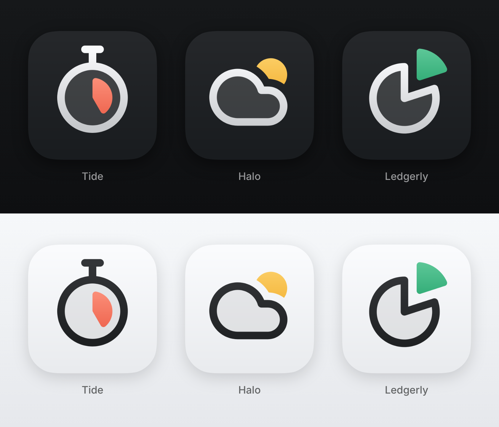

# rian-app-icon

一个 Claude skill：把一句产品描述变成一枚可以上架的 app 图标（1024 SVG 母版，默认、浅色、深色、单色四种平面外观，Icon Composer 三组分层和 iOS 26 六种外观的预览，评审对照图，Android、Play、PWA、favicon 导出文件，App Store A/B 变体）。

风格只有一种：**石墨线稿**。深石墨底上一笔亮色圆头细线画出物件，物件里面垫一层半透明白的平涂实形，强调色是一块填色，只点一处。

- **线稿**：主体是 1–4 段相连的线，1024 下 60 px，只有一种线宽，圆头圆角，线本身不填色。和界面里 1.5 px 的 Lucide 图标是同一种线，图标和界面一看就是一个品牌。
- **净空**：分开的线之间、线和强调色之间都至少隔一个线宽（60）。64 px 及以下的 small 版线加粗到 76，29 px 下约 2.2 px。
- **石墨底和顶光**：底是 `#26282B → #191C1F` 的竖直渐变，线是 `#F8F9FB → #C6C8CB` 的顶光渐变。不画投影、高光、辉光，也不用滤镜，iOS 26 的 Liquid Glass 由系统自己加。
- **体积层**：线围出的物件内部是一块 `#FFFFFF` 14 % 的平涂实形，边沿藏在线下。Apple 要图标用重叠的实形和不同透明度的层，Liquid Glass 在这一层上做出厚度。
- **一块强调色**：六色之一，一块填色（扇形、太阳、胶囊、斜带），不描边，占 6–20 %，可以压在体积层上。填色在 29 px 和单色 50 % 灰下还在，彩色的细线不在。
- **类别记号**：工具（蓝）是一条横贯整幅的水平直线，图片（黄）是左上角的圆太阳，视频（珊瑚）是线画的播放三角，AI（紫）是右下角的 45° 斜角和「/」斜带；绿只给健康和财务。用户靠图形认类别，不靠颜色。
- **平台规格**：1024 全出血母版、Icon Composer 三组（体积层、线稿、强调色）和六种外观（默认、深色、Clear 浅 / 深、Tinted 浅 / 深）学 Apple；自适应图标三层、主题图标和 Play 512 学 Google。



| 示例 | 强调色 | 画了什么 |
|---|---|---|
| Tide 专注计时 | 珊瑚 | 秒表：表圈、柄和冠钮一笔画，珊瑚扇形是 25 分钟的进度 |
| Halo 天气 | 黄 | 一笔画的云，右上方露出一弯太阳 |
| Ledgerly 记账（财务） | 绿 | 一笔画的饼图，缺的 72° 切片抽出来填绿 |

## 姊妹 skill：App UI 主题

用同一套强调色生成整套 UI 主题（石墨中性色阶梯、标准和高对比两套 token、字号、圆角、动效，导出 CSS、SwiftUI、Compose、Tailwind），在单独的仓库：[RianStudio/app_ui_design_skill](https://github.com/RianStudio/app_ui_design_skill)。图标的强调色是蓝、绿、紫时，界面主色跟图标同色；珊瑚、黄、灰只留在图标里，界面用蓝。

## 安装

**Claude Code**：把整个仓库复制到 `~/.claude/skills/rian-app-icon/`（个人）或项目里的 `.claude/skills/rian-app-icon/`。

**Claude.ai / Claude 桌面版**：把仓库打成 zip，在 Settings → Capabilities → Skills 上传。

渲染脚本需要 Python 3.9 及以上，一次性安装：

```bash
pip install playwright pillow numpy && playwright install chromium
```

## 用法

直接对 Claude 说，例如：

> 给我做一个 app 图标：「Tide」，把待办拆成 25 分钟专注块的计时器。

Claude 会读懂产品、自己选定隐喻和配色、从模板画 SVG、渲染并按指标自检（最多两轮），然后交付四种平面外观和 Icon Composer 分层。

也可以自己渲染：

```bash
python3 scripts/render.py icon.svg -o renders                       # 1024 PNG + 对照图 + 指标报告
python3 scripts/render.py icon.svg -o renders --variants            # 另出浅色、深色、单色、small 版和两份平涂的 mark（界面品牌插图：-mark 亮线配深色面板，-mark-light 深线配浅色面板）
python3 scripts/render.py icon.svg -o renders --variants --export   # 另出 Icon Composer、Android、Play、PWA、favicon 文件
python3 scripts/render.py icon.svg -o renders --store-ab           # 另出商店 A/B 变体（浅一档底、细亮边、类别色底）和对比图
python3 scripts/render.py icon.svg -o renders --json                # 指标另存为 JSON
python3 scripts/overview.py examples/tide.svg icon.svg -o renders/compare.png   # 新图标和 Tide 并排，看轻重
python3 scripts/series.py icon.svg --with a.svg b.svg -o renders    # 系列检查：和已有图标一起出 40 / 29 px 对照，标出像的配对和扎堆的强调色（不写 --with 时和示例比）
python3 scripts/shapes.py                                           # 线的中线（圆弧、圆角矩形、气泡、多边形和折线、播放三角）和强调色（胶囊、AI 斜带、扇形、环段、弓形、路径相减）的用法
```

指标报告逐条打印 PASS / FAIL / INFO：线宽和圆头圆角、线条段数、线间净空、夹缝、强调色到线、强调色占比、尺寸、墨量和重心（和 Tide 比，不对时直接给出该改的 k 和 translate）、渐变跨度、色板、亮度对比、体积层、辉光和滤镜、类别记号、商店边缘、安卓主题图标、小尺寸（40 / 29 / 16 px）、Android / PWA 缩放系数。

## 结构

```
SKILL.md                    工作流程（入口）、示例索引、无字母品类的画法
references/style.md         风格原则、线宽的来由、全部数字和测量口径、配色、类别记号、商店 A/B 变体、系列检查、禁忌、验收清单
references/construction.md  图层结构、属性和类、几何速查（shapes.py、四类记号的常用写法）、外观配方、平台导出、商店 A/B 变体、渲染参数
references/sources.md       一手来源与致谢
assets/template.svg         图标模板（用 Tide 写成）：只改 TODO 的地方
scripts/render.py           SVG → 1024 PNG、对照图、指标报告；外观、Icon Composer 分层、平台导出和商店 A/B 变体（Chromium 渲染）
scripts/shapes.py           线的中线（圆弧、圆角矩形、气泡、圆角多边形和折线、播放三角）和强调色的轮廓（胶囊、AI 斜带、扇形、环段、弓形），路径相减（minus：强调色减去线外扩 90）
scripts/series.py           系列检查：新图标和已有图标的 40 / 29 px 对照表、配对相似分数、强调色位置登记
scripts/overview.py         三枚示例并排的总览图（README 顶部那张）：深底一行，浅色外观一行
examples/                   Tide、Halo、Ledgerly 三枚示例；renders/ 里是每枚的 1024 母版、对照图（-sheet.png）和三枚并排的 overview.png
```

## 许可

MIT
